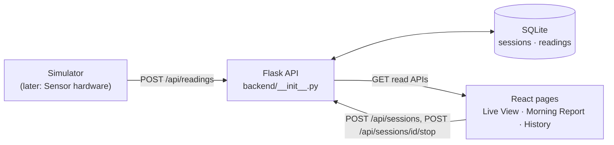
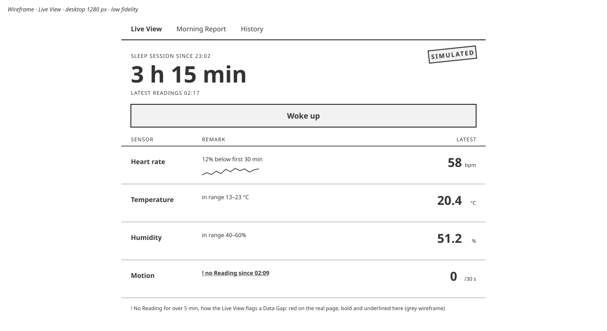
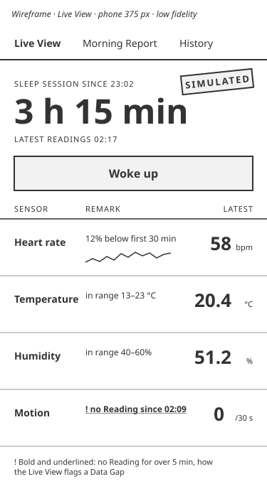
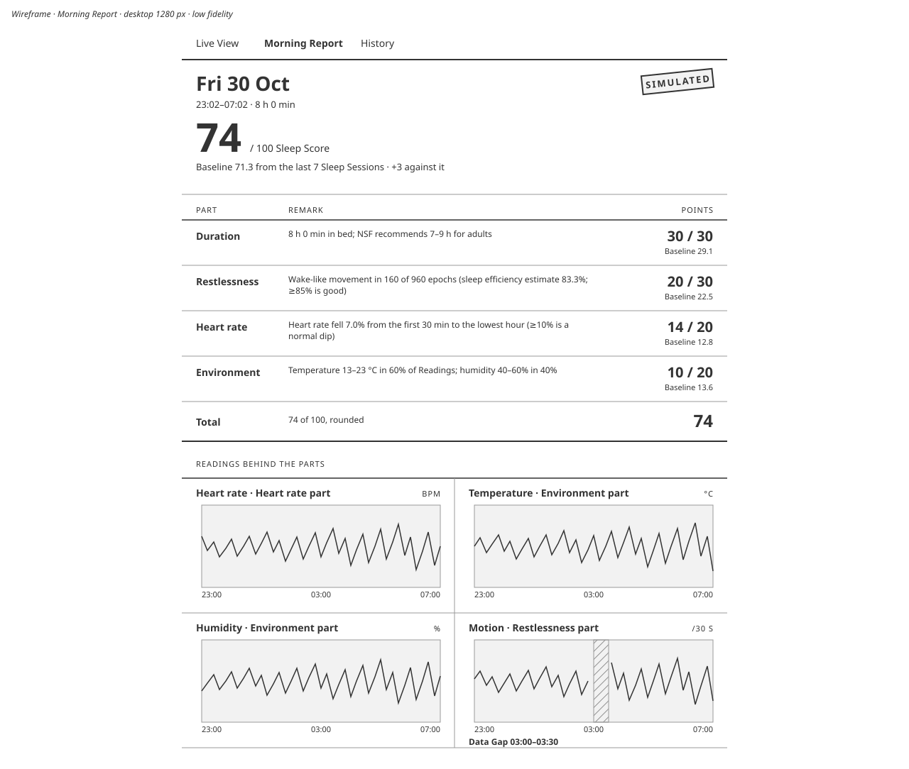
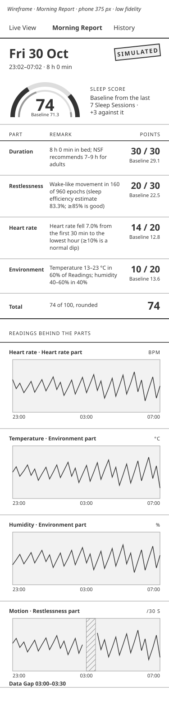
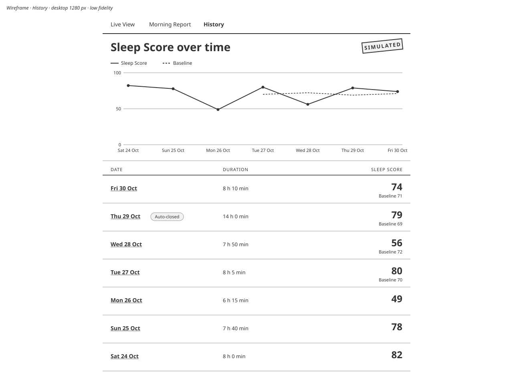
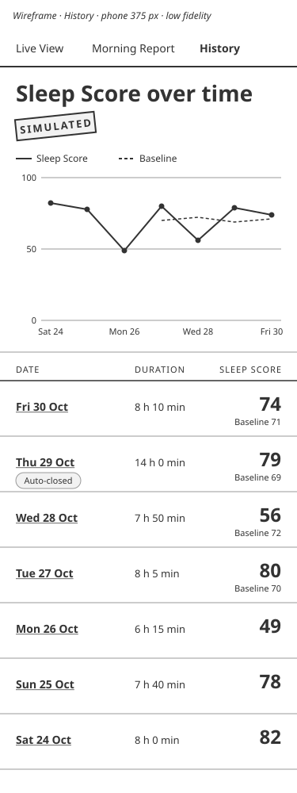

# Architecture

Terms are defined in [GLOSSARY.md](../../GLOSSARY.md); the scope is set by [ADR 0001](../adr/0001-rescope-to-rule-based-software-mvp.md).
All demo data is Simulated: every Reading comes from the Simulator, not real hardware.



## Schema

`backend/schema.sql`:

```sql
CREATE TABLE IF NOT EXISTS sessions (
  id INTEGER PRIMARY KEY,
  started_at TEXT NOT NULL,
  ended_at TEXT,
  auto_closed INTEGER NOT NULL DEFAULT 0,
  opened_at TEXT NOT NULL DEFAULT (strftime('%Y-%m-%dT%H:%M:%SZ', 'now'))  -- server wall clock, never client-supplied
);
CREATE TABLE IF NOT EXISTS readings (
  id INTEGER PRIMARY KEY,
  session_id INTEGER NOT NULL REFERENCES sessions(id),
  sensor TEXT NOT NULL,
  value REAL NOT NULL,
  recorded_at TEXT NOT NULL,
  simulated INTEGER NOT NULL
);
CREATE INDEX IF NOT EXISTS idx_readings_session_sensor_time ON readings (session_id, sensor, recorded_at);
```

- `opened_at` is the server clock when the row was inserted. It only drives auto-close; `started_at` is what the Sleeper (or the Simulator) says.
- `value` is REAL for every Sensor, but the API returns `motion` as an integer.
- The index on `(session_id, sensor, recorded_at)` serves the per-Sensor Reading and Data Gap queries.

## API contract

The pages' types are in [`frontend/src/lib/api.ts`](../../frontend/src/lib/api.ts); the contract tests that check them against the live API are in [`frontend/tests/contract/`](../../frontend/tests/contract/).

- Every error is `{"error": "<message>"}` with the HTTP status.
- Timestamps are accepted as any ISO 8601 with a timezone, and stored and returned in UTC as `YYYY-MM-DDTHH:MM:SSZ`.
- Session: `{id, started_at, ended_at, auto_closed, score, simulated}`. `ended_at` is null while running; `score` is null until it ends; `simulated` is true if any of its Readings is Simulated.
- Score: `{total, parts: [{name, points, max, detail}], excluded: [name]}`.

| Route | Request | Response |
| --- | --- | --- |
| `GET /api/health` | | 200 `{"status": "ok"}` |
| `POST /api/sessions` | `{started_at?}` (default now) | 201 Session |
| `POST /api/sessions/<id>/stop` | `{ended_at?}` | 200 Session |
| `GET /api/sessions` | | 200 `[Session]`, newest first (`started_at DESC, id DESC`) |
| `GET /api/sessions/current` | | 200 the running Session, or 404 |
| `GET /api/sessions/<id>` | | 200 Session plus `gaps`, `baseline`, `baseline_reason` |
| `GET /api/sessions/<id>/readings?sensor=` | optional `sensor` filter | 200 `[Reading]`, oldest first |
| `POST /api/readings` | `[Reading]` | 201 `{accepted, rejected: [{index, reason}]}` |

A Reading is `{sensor, value, recorded_at, simulated}`.

**`POST /api/sessions`** errors:

- 409 `"a Sleep Session is already running"`
- 400 `"started_at must be an ISO 8601 timestamp with a timezone"`
- 400 `"started_at is more than 5 minutes in the future"`

Overlapping a stopped Sleep Session is accepted: a live Simulator run stops at a simulated end that may be in the future. Only one Sleep Session may be running.

**`POST /api/sessions/<id>/stop`**: `ended_at` defaults to the later of now and `started_at`. Errors:

- 404 `"no such Sleep Session"`
- 409 `"this Sleep Session has already ended"`
- 400 `"ended_at must be an ISO 8601 timestamp with a timezone"`
- 400 `"ended_at is before started_at"`

**`GET /api/sessions/current`**: 404 `"no Sleep Session is running"` when none is.

**`GET /api/sessions/<id>`** (404 `"no such Sleep Session"`; `/readings` has the same 404) adds:

- `gaps`: `[{sensor, start, end}]`, null while running.
- `baseline`: `{total, parts: [{name, points}], sessions_used}`, or null.
- `baseline_reason`: why `baseline` is null, else null.

**`POST /api/readings`** takes a list of Readings for the running Sleep Session. Valid Readings are stored even when others in the batch are rejected (a partial batch is 201). Errors:

- 400 `"body must be a list of Readings"`
- 409 `"no Sleep Session is running"`

## Bad-data rules

A rejected Reading gets one reason, the first failing check in this order:

| Reason | When |
| --- | --- |
| `"unknown sensor"` | not an object, or `sensor` is not one of the five names |
| `"non-numeric value"` | `value` is not a number (booleans included) |
| `"bad timestamp"` | `recorded_at` is not ISO 8601 with a timezone |
| `"out of range"` | outside the range below, or a non-integer `motion` |
| `"missing simulated flag"` | `simulated` is not a boolean |
| `"outside session"` | before the running Sleep Session's `started_at`, or more than 14 h after it |

Ranges: heart_rate 30–220 bpm, temperature −10–50 °C, humidity 0–100 %, motion an integer ≥ 0 per 30 s, sound 0–140 dB.

"Outside session" has no cap at now, because the Simulator replays on its own clock.

**Auto-close.** A Sleep Session still running 14 h after its `opened_at` is closed at its last Reading (or `started_at` if it has none) and marked `auto_closed`. This happens lazily on each request, not on a timer.

**Data Gap.** More than 5 min between consecutive Readings of one Sensor, counting the Sleep Session's start and end as edges. A required Sensor with no Readings is one gap covering the whole Sleep Session; sound is optional, so none is no gap. Gaps exist only once the Sleep Session has ended.

**Sleep Score.** Parts: duration 30, restlessness 30, heart_rate 20, environment 20. Thresholds and sources are in [`../research/sleep-score.md`](../research/sleep-score.md).

- A Sensor is unusable with no Readings or with Data Gaps covering more than half the Sleep Session. Its part is left out, listed in `excluded`, and the total is scaled to 100.
- Environment uses whichever of temperature and humidity is usable.
- If only duration is left, the score is null.
- Readings after `ended_at` are ignored.
- Sound is not scored.

**Baseline.** The mean of up to 7 earlier Sleep Sessions that ended, were not auto-closed, and have a Sleep Score. With fewer than 3 it is null and `baseline_reason` is `"Baseline still building: n of 3 past Sleep Sessions"`.

## Wireframes

Low fidelity, at the width of the real pages' main column.

| | Desktop | Phone |
| --- | --- | --- |
| Live View |  |  |
| Morning Report |  |  |
| History |  |  |
